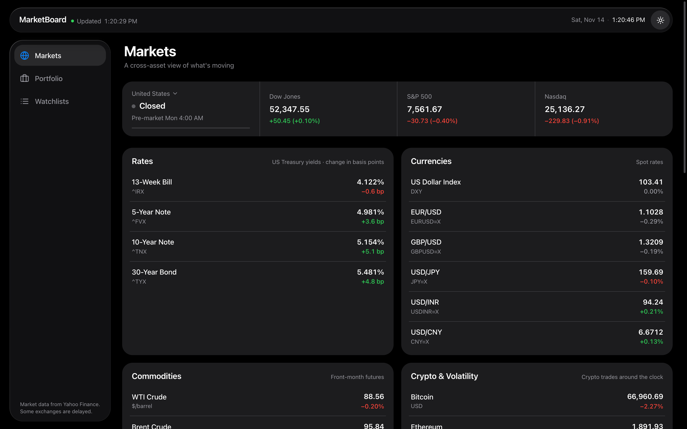
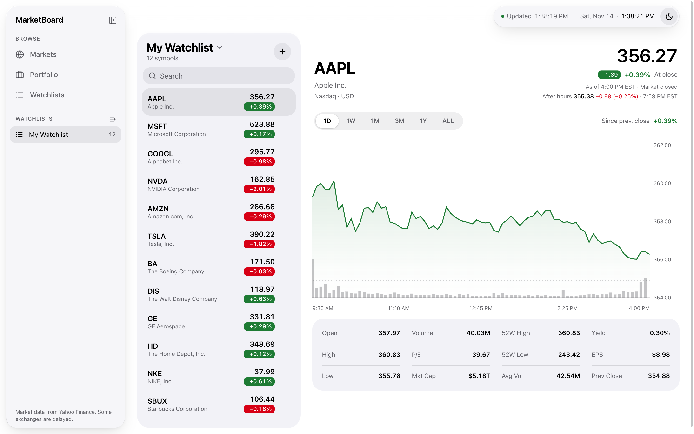
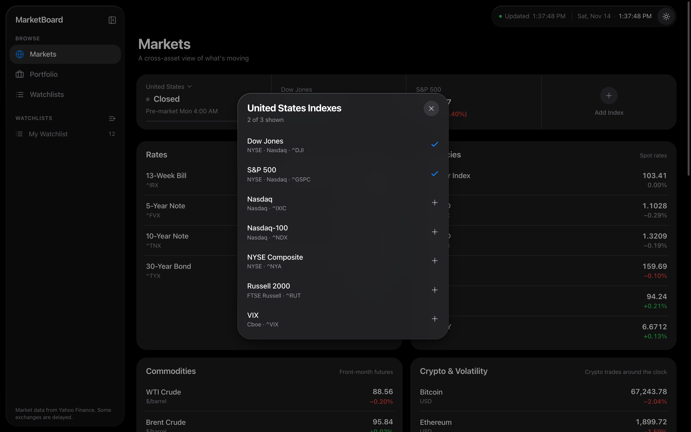
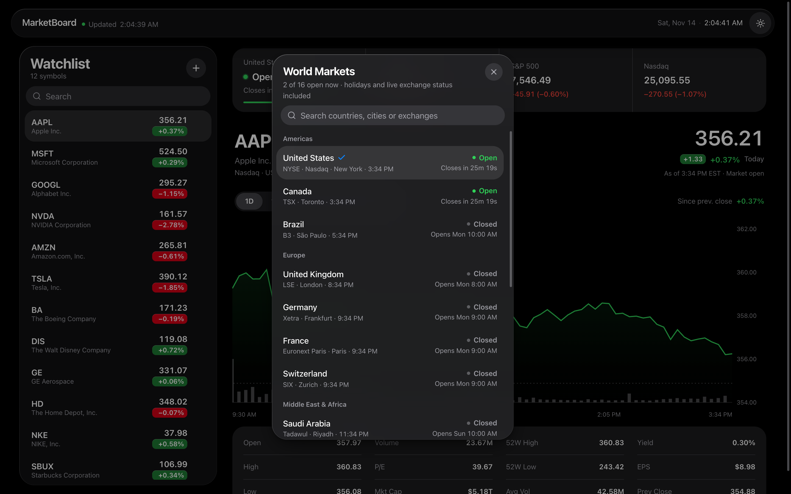
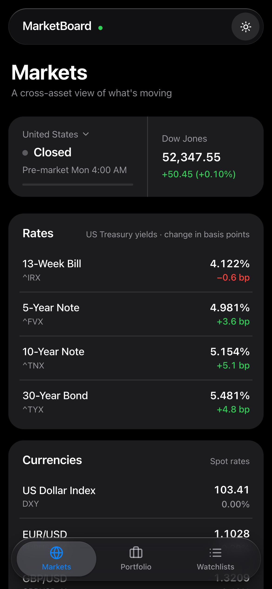

# MarketBoard

A live stock watchlist with an Apple-style Liquid Glass interface, built with Next.js. Quotes, charts, index levels and ticker search come from Yahoo Finance through a small server route, so no API key is needed.

<!--
Screenshots: add these files, then uncomment the image lines below.
  docs/screenshots/dark.png          full window, dark appearance
  docs/screenshots/light.png         full window, light appearance
  docs/screenshots/index-picker.png  the index sheet open (e.g. India Indexes)
  docs/screenshots/world-markets.png the World Markets sheet open
  docs/screenshots/mobile.png        phone width



-->

## Features

- **Watchlist sidebar.** Twelve default symbols with price, daily change and a mini trend line. Search the list, add any ticker through Yahoo Finance autocomplete, or remove one with the red minus button.
- **Detail view.** A large price header, a 1D / 1W / 1M / 3M / 1Y / ALL range control and an area chart. Moving the pointer across the chart shows the price and change at that point in the header, the way Apple's Stocks app does. The 1D chart draws a dotted line at the previous close.
- **Fundamentals.** Open, high, low, previous close, volume, average volume, market cap, P/E, EPS, dividend yield and the 52-week range, all taken from the live quote.
- **World market hours.** The first tile shows whether a market is open, in pre-market, after hours, on a lunch break or closed, with a countdown and a progress bar for the session. Tap it to see 16 markets worldwide with their local time and status, and pick one.
- **Indexes that follow the market.** The strip next to the tile shows up to three indexes for the market you picked: Dow Jones, S&P 500 and Nasdaq for the United States; Nifty 50 (NSE) and Sensex (BSE) for India; FTSE 100 for the UK; Nikkei 225 for Japan; and so on, 44 indexes in all. Tap **Add Index** to choose from that market's list, which shows the exchange each index belongs to, and **×** to remove one. Each market remembers its own choice in the browser.
- **Light and dark appearance.** Follows your system setting on load. The sun/moon button switches it.
- **Responsive layout.** On a phone the sidebar stacks above the chart and the index strip scrolls sideways.

<!--
| Choose indexes | World market hours |
| --- | --- |
|  |  |

<p align="center">
  
</p>
-->

## Design

The interface follows Apple's Liquid Glass approach: content sits on a plain black or white background, and glass is used only for the floating layer of controls.

- **Glass surfaces.** The toolbar, the watchlist sidebar, sheets and toasts are translucent with background blur, a thin highlight along the top edge and a soft shadow.
- **Edge refraction.** In Chromium browsers (Chrome, Edge, Brave, Arc) the toolbar also bends the content scrolling beneath it at its rim. This uses an SVG displacement map applied with `backdrop-filter`. Safari and Firefox get the frosted blur without the bending.
- **System palette.** Colors are Apple's system values for labels, separators, fills, green, red and blue, with separate light and dark sets.
- **Motion.** Prices roll digit by digit when they change. The range control and the watchlist selection slide between items on spring animations.

## Where the data comes from

All market data comes from Yahoo Finance through [`yahoo-finance2`](https://github.com/gadicc/node-yahoo-finance2), called from the server route in `app/api/stocks/route.ts`. Some values are derived rather than fetched, and this table says which:

| Data | Source |
| --- | --- |
| Price, change, open, high, low, previous close | Live Yahoo quote |
| Volume, average volume, market cap, 52-week range | Live Yahoo quote |
| P/E, EPS, dividend yield, exchange, currency | Live Yahoo quote |
| Index levels (`^DJI`, `^NSEI`, `^BSESN`, `^N225`, …) | Live Yahoo quote for the real index |
| Chart history for every range | Live Yahoo chart data |
| Ticker search | Live Yahoo search |
| Mini trend lines in the watchlist and index strip | **Derived.** Drawn from the day's open, high, low and current price, not real intraday ticks |
| Market open/closed status | **Computed** from each exchange's regular hours and time zone. Exchange holidays are not included |

The app checks for new quotes every 10 seconds and new index levels every 12 seconds. If Yahoo is unreachable or rate-limits the server, the app switches to simulated prices so it still works offline. The toolbar then shows **Simulated** in place of **Live**, and a notification tells you the live feed is unavailable.

Yahoo Finance has no official public API, so `yahoo-finance2` depends on unofficial endpoints. Heavy use can be rate-limited for a while.

## Getting started

You need Node.js 20.9 or later.

```bash
git clone https://github.com/shreyescodes/market-board-stocks.git
cd market-board-stocks
npm install
npm run dev
```

Then open http://localhost:3000.

| Command | What it does |
| --- | --- |
| `npm run dev` | Start the development server |
| `npm run build` | Create a production build |
| `npm start` | Serve the production build |

## API route

The front end talks only to `GET /api/stocks`:

| Query | Returns |
| --- | --- |
| `?action=quotes&symbols=AAPL,^GSPC` | Quotes and fundamentals for each symbol |
| `?action=chart&symbol=AAPL&timeframe=1M` | Price history for `1D`, `1W`, `1M`, `3M`, `1Y` or `ALL` |
| `?action=search&query=netflix` | Up to five matching stocks or ETFs |

## Project structure

```
app/
  api/stocks/route.ts     Yahoo Finance proxy: quotes, chart history, search
  globals.css             Design tokens and the glass material
  layout.tsx, page.tsx
components/
  stock-ticker-page.tsx   Page shell, state, polling and theme
  header.tsx              Floating glass toolbar
  watchlist-table.tsx     Glass sidebar: search, add, select, remove
  stock-details.tsx       Price header, range control, chart, fundamentals
  market-bar.tsx          Market-status tile, index strip and both pickers
  liquid-glass.tsx        Glass surface, edge refraction, rolling numbers, change pill
  sheet.tsx               Glass sheet used by the pickers
  sparkline.tsx           Mini trend line
lib/
  indices.ts              Indexes for each market, with their exchange
  markets.ts              Exchange hours and the open/closed status logic
  stock-data.ts           Client fetch helpers and the offline simulation
  stock-types.ts
```

## Tech stack

- [Next.js 16](https://nextjs.org) with the App Router, React 19 and TypeScript
- [Tailwind CSS 4](https://tailwindcss.com)
- [Framer Motion](https://motion.dev) for animation
- [Recharts](https://recharts.org) for the chart
- [yahoo-finance2](https://github.com/gadicc/node-yahoo-finance2) for market data
- [Sonner](https://sonner.emilkowal.ski) for notifications and [Lucide](https://lucide.dev) for icons

## Limitations

- Market status uses regular trading hours only. On exchange holidays a market can show as open when it is actually closed.
- The watchlist and index-strip trend lines are drawn from daily figures, not real intraday data.
- Edge refraction works only in Chromium browsers.
- Your watchlist itself is not saved. Reloading the page restores the twelve default symbols. Only the chosen market and each market's indexes persist.
