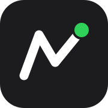
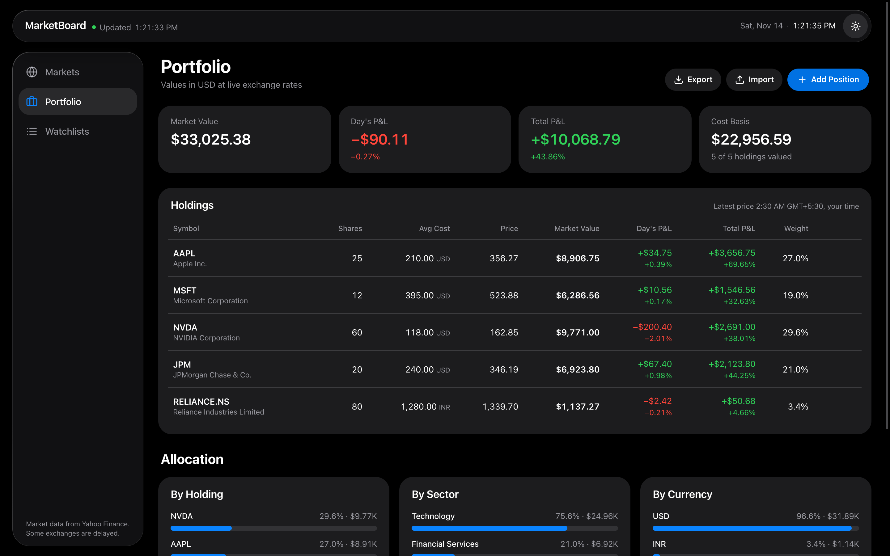

# MarketBoard

A markets dashboard, portfolio tracker and watchlist app with an Apple-style Liquid Glass interface, built with Next.js. Quotes, charts, index levels, rates, currencies, commodities, movers and ticker search come from Yahoo Finance through a small server route, so no API key is needed.


## Features

A full-height glass sidebar switches between three sections and lists your watchlists, the way Music lists playlists. Hide it to an icon rail with the sidebar button or **⌃⌘S**; your choice is remembered. On medium-width screens it shows as the icon rail, and on phones it becomes a floating tab bar. Every symbol anywhere in the app opens its own page.

### Markets
- **Market status and indexes.** The first tile shows whether a market is open, in pre-market, after hours, on a lunch break, closed or on holiday, with a countdown and a progress bar for the session. Tap it to see 16 markets worldwide with their local time and status, and pick one.
  - **Holidays and early closes** are built in: "Holiday · Thanksgiving Day · Pre-market Fri 4:00 AM", "Early close in 1h 30m".
  - **Countdowns skip holidays,** so on the Friday before Martin Luther King Jr. Day the US shows "Pre-market Tue 4:00 AM".
  - **Indexes follow the market:** Dow Jones, S&P 500 and Nasdaq for the United States; Nifty 50 (NSE) and Sensex (BSE) for India; FTSE 100 for the UK; Nikkei 225 for Japan; and so on, 44 indexes in all. Tap **Add Index** to choose from that market's list and **×** to remove one, up to three. Each market remembers its own choice.
- **Cross-asset view.**
  - **Rates:** US Treasury yields (13-week, 5, 10 and 30-year), with changes in basis points.
  - **Currencies:** the dollar index and major pairs.
  - **Commodities:** front-month futures for oil, gas, gold, silver and copper.
  - **Crypto and volatility:** Bitcoin, Ethereum and the VIX.
- **US sectors.** A heatmap of the 11 S&P 500 sectors (Select Sector SPDR ETFs), tinted by the size of today's move.
- **US movers.** Top gainers, top losers and most active, from Yahoo's screeners, refreshed every minute.

| Choose indexes | World market hours |
| --- | --- |
|  |  |

### Portfolio
- **Positions.** Add holdings with shares and average cost; buying more of something you already hold merges into one position at the weighted average cost. Edit or remove a position (with **Undo**).
- **Valuation in USD.**
  - **Totals:** market value, day's P&L, total P&L and cost basis, per position and overall.
  - **Currency conversion:** holdings in other currencies use live exchange rates. Day's P&L includes currency moves, and prices quoted in pence or other minor units are handled.
  - **Missing data:** a holding with no quote or exchange rate is left out of the totals and flagged, never estimated.
- **Allocation.** By holding, by sector and by currency, as ranked bars.
- **Backup.** **Export** downloads your watchlists and portfolio as a JSON file; **Import** restores one after a confirmation.



<sub>The portfolio above is an example; prices and exchange rates are live.</sub>

### Watchlists
- **Multiple lists.** Create, rename, switch and delete named watchlists.
- **The list.** Price and daily change for each symbol. Search it, add any ticker through Yahoo Finance autocomplete, or remove one with the × button that appears on hover (or the Delete key), with **Undo**.
- **Detail view.** Selecting a symbol shows its full page beside the list.

### Symbol pages
- **Chart.** A large price header, a 1D / 1W / 1M / 3M / 1Y / ALL range control, and a price chart with a time axis and volume bars. Moving the pointer across the chart shows the price, change and time at that point in the header, the way Apple's Stocks app does.
  - **1D:** shows the latest regular trading session, with a dotted line at the official previous close.
  - **Times:** all chart times are in the exchange's own time zone.
- **Freshness.** Under the price you'll see when the quote is from and the market session, for example "As of 3:12 PM EST · Market open". If the quote falls behind during trading you'll see how far ("6 min behind"). Pre-market and after-hours prices appear when Yahoo has them.
- **Fundamentals.** Open, high, low, previous close, volume, average volume, market cap, P/E, EPS, dividend yield and the 52-week range, all taken from the live quote.
- **Actions.** **Add to Watchlist** and **Add to Portfolio** from any symbol page. Each symbol has its own link, e.g. `/symbol/AAPL`.

### Throughout
- **Light and dark appearance.** Follows your system setting on load. The sun/moon button switches it.
- **Responsive layout.** Sidebar navigation on desktop; a floating glass tab bar on phones.
- **Storage.** Watchlists, positions, and market and index choices are saved in this browser, and kept in sync across open tabs.

<p align="center">
  
</p>

<sub>Screenshots taken from the running app with live Yahoo Finance data on Saturday, November 14, 2026, so markets show as closed with Friday's closing prices.</sub>

## Design

The interface follows Apple's Liquid Glass approach: content sits on a plain black or white background, and glass is used only for the floating layer of controls.

- **Layout like a macOS app.** The sidebar is a full-height floating glass pane carrying the app name and the sidebar toggle. The toolbar (feed status, clock and appearance) floats over the content area only, and content softens as it scrolls beneath it.
- **Glass surfaces.** The sidebar, the toolbar, the phone tab bar, sheets and toasts are translucent with background blur, a thin highlight along the top edge and a soft shadow. Lists, charts and tables are plain content and never glass.
- **Edge refraction.** In Chromium browsers (Chrome, Edge, Brave, Arc) the toolbar and the phone tab bar also bend the content scrolling beneath them at their rims. This uses an SVG displacement map applied with `backdrop-filter`. Safari and Firefox get the frosted blur without the bending.
- **System palette.** Colors are Apple's system values for labels, separators, fills, green, red and blue, with separate light and dark sets.
- **Motion.** Prices roll digit by digit when they change. The navigation, range control and watchlist selection slide between items on spring animations, and sheets grow out of the control that opened them.
- **Accessibility.** Text and color-coded values meet WCAG AA contrast (4.5:1) in both appearances. Everything works by keyboard: arrow keys move through the chart ranges, Delete removes the focused watchlist row, and open sheets keep focus inside until closed.

## Where the data comes from

All market data comes from Yahoo Finance through [`yahoo-finance2`](https://github.com/gadicc/node-yahoo-finance2), called from the server route in `app/api/stocks/route.ts`. Some values are derived rather than fetched, and this table says which:

| Data | Source |
| --- | --- |
| Price, change, open, high, low, previous close | Live Yahoo quote |
| Volume, average volume, market cap, 52-week range | Live Yahoo quote |
| P/E, EPS, dividend yield, exchange, currency | Live Yahoo quote |
| Index levels (`^DJI`, `^NSEI`, `^BSESN`, `^N225`, …) | Live Yahoo quote for the real index |
| Chart history for every range | Live Yahoo chart data, regular-session bars only |
| Pre-market and after-hours prices | Live Yahoo quote |
| Rates, currencies, commodities, crypto, VIX, sector ETFs | Live Yahoo quotes |
| US movers (gainers, losers, most active) | Live Yahoo predefined screeners |
| Sector and country for portfolio allocation | Yahoo company profile, cached for a day |
| Exchange rates for portfolio valuation | Live Yahoo FX quotes (`INRUSD=X`, `GBPUSD=X`, …) |
| Ticker search | Live Yahoo search |
| Market open/closed status | **Computed** from each exchange's hours and holiday rules, then **checked live** against Yahoo's session state for the market's main index |

**The app never invents data.** If Yahoo can't be reached, the last real prices stay on screen unchanged and the toolbar says **Reconnecting** with the time of the last good update. If there is no data at all, prices show "—" and the toolbar says **Offline**. A chart with no data shows an empty state with a **Try Again** button.

**Refresh rates.** Each of these is one batched request:
- **Every 10 seconds:** watchlist, portfolio and symbol-page quotes, including the exchange rates the portfolio needs.
- **Every 12 seconds:** index levels in the strip.
- **Every 15 seconds:** rates, currencies, commodities, crypto and sectors on the Markets page.
- **Every minute:** US movers, live market status for all 16 markets, and the open 1D chart.
- **Once a day:** company profiles (sector and country), cached on the server.

The server caches results briefly, so several open tabs don't multiply the load on Yahoo. Refreshing slows down while the feed is failing and pauses while the tab is hidden.

Yahoo Finance has no official public API, so `yahoo-finance2` depends on unofficial endpoints. Heavy use can be rate-limited for a while.

## Getting started

You need Node.js 20.9 or later.

```bash
git clone https://github.com/shreyescodes/market-board-stocks.git
cd market-board-stocks
npm install
npm run dev
```

Then open http://localhost:3000.

| Command | What it does |
| --- | --- |
| `npm run dev` | Start the development server |
| `npm run build` | Create a production build |
| `npm start` | Serve the production build |

## API route

The front end talks only to `GET /api/stocks`:

| Query | Returns |
| --- | --- |
| `?action=quotes&symbols=AAPL,^GSPC` | Quotes, fundamentals, session state and extended-hours prices. `stale: true` means Yahoo is unreachable and these are the last good values |
| `?action=chart&symbol=AAPL&timeframe=1M` | Price and volume history for `1D`, `1W`, `1M`, `3M`, `1Y` or `ALL`, with the exchange's time zone |
| `?action=movers` | Top 10 US gainers, losers and most active. Cached for a minute |
| `?action=profiles&symbols=AAPL,SPY` | Sector, industry, country and instrument type. Cached for a day |
| `?action=search&query=netflix` | Up to five matching stocks or ETFs |

## Project structure

```
app/
  layout.tsx              Root layout: wraps every page in the app shell
  page.tsx                Markets
  portfolio/page.tsx      Portfolio
  watchlists/page.tsx     Watchlists
  symbol/[symbol]/page.tsx  A page per symbol
  api/stocks/route.ts     Yahoo Finance proxy: quotes, charts, movers, profiles, search
  globals.css             Design tokens and the glass material
components/
  app-shell.tsx           Collapsible glass sidebar, page layout and phone tab bar
  workspace.tsx           Shared state: watchlists, positions and feed health
  markets-view.tsx        Markets page
  portfolio-view.tsx      Portfolio page
  position-sheet.tsx      Add / edit a position
  watchlists-view.tsx     Watchlists page
  watchlists-sheet.tsx    Switch, create, rename and delete watchlists
  watchlist-table.tsx     The watchlist: search, add, select, remove
  symbol-view.tsx         Symbol page
  stock-details.tsx       Price header, range control, chart, fundamentals
  market-bar.tsx          Market-status tile, index strip and their pickers
  header.tsx              Floating glass toolbar (desktop) and top bar (phone)
  liquid-glass.tsx        Glass surface, edge refraction, rolling numbers, change pill
  sheet.tsx               Glass sheet used for pickers and forms
hooks/
  use-poll.ts             Polling with back-off that pauses in hidden tabs
  use-quotes.ts           Batched live quotes for any set of symbols
lib/
  storage.ts              Browser storage, migration and backup files
  portfolio.ts            Portfolio valuation in USD and allocation
  indices.ts              Indexes for each market, with their exchange
  markets.ts              Exchange hours and the open/closed status logic
  holidays.ts             Holiday and early-close calendars computed from exchange rules
  stock-data.ts           Client fetch helpers (quotes, charts, movers, profiles)
  format.ts               Price, money and time formatting per currency and time zone
  stock-types.ts
```

## Tech stack

- [Next.js 16](https://nextjs.org) with the App Router, React 19 and TypeScript
- [Tailwind CSS 4](https://tailwindcss.com)
- [Framer Motion](https://motion.dev) for animation
- [Recharts](https://recharts.org) for the chart
- [yahoo-finance2](https://github.com/gadicc/node-yahoo-finance2) for market data
- [Sonner](https://sonner.emilkowal.ski) for notifications and [Lucide](https://lucide.dev) for icons

## Privacy

- **No accounts.** Your watchlists and positions are stored only in your browser, never on a server.
- **What leaves the browser:** to fetch prices, the app sends ticker symbols (for example `AAPL`) to its own server route, which asks Yahoo Finance. Share counts, costs and portfolio values are never sent.
- **Analytics:** the layout includes [Vercel Web Analytics](https://vercel.com/docs/analytics), which collects anonymous page views only when the app is deployed on Vercel with Analytics turned on. It does nothing locally.

## Limitations

- **Two kinds of holiday coverage:**
  - **Rule-based calendars** cover 10 markets: the US, Canada, Brazil, the UK, Germany, France, Switzerland, South Africa, Australia and Japan.
  - **Live status only** for China, Hong Kong, India, South Korea, Singapore and Saudi Arabia. Their holidays come from lunar or religious calendars announced each year, so on the day these markets show **Closed Today** once Yahoo confirms there has been no trading, but countdowns before the holiday don't account for it.
- **Unpredictable closures:** rules can't foresee one-off closures such as state funerals or emergencies. The live check catches those on the day.
- **Clock changes:** countdowns that span a daylight-saving change can be off by an hour.
- Edge refraction works only in Chromium browsers.
- **Browser-only storage.** Watchlists and positions live in this browser. They don't sync to other devices, and clearing site data erases them, so use **Export** to keep a backup.
- **Portfolio cost basis** is converted to USD at today's exchange rate, not the rate on the day you bought. Positions are a single average cost per symbol, not individual lots, and there are no realized gains, dividends or taxes. It is a tracker, not a brokerage record.
- **Movers and sectors are US-only,** because those are the screeners and sector funds Yahoo provides.
