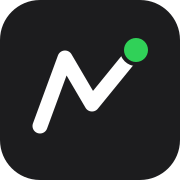
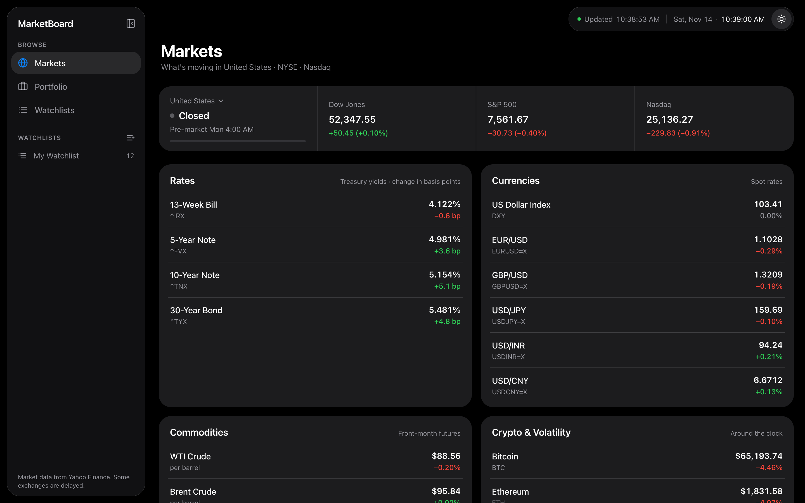
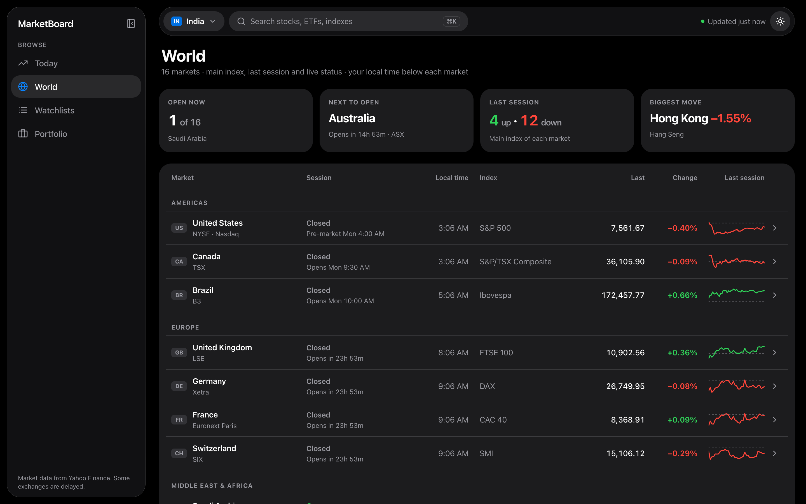
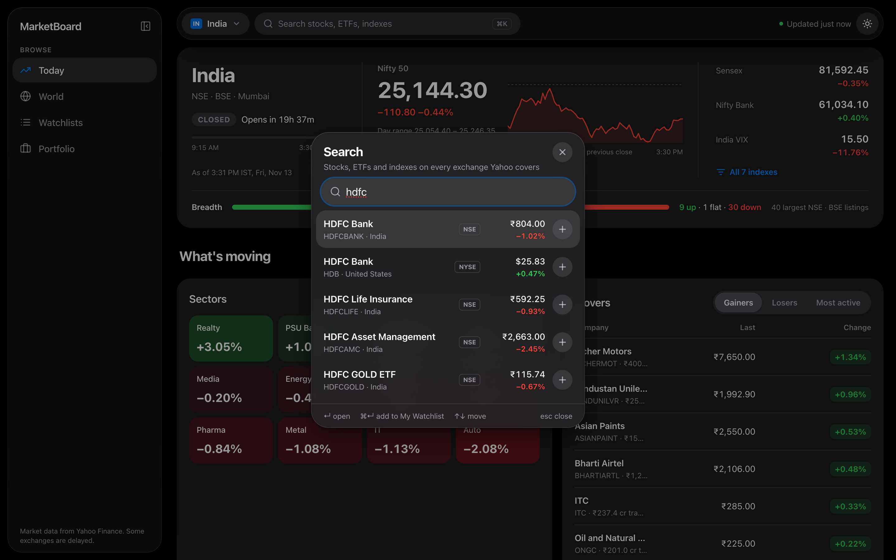
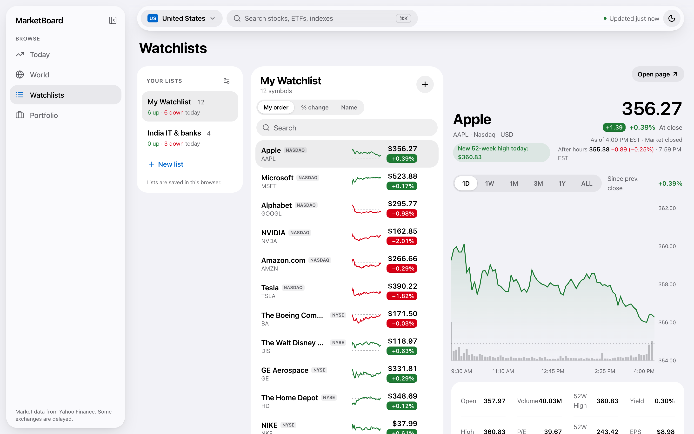
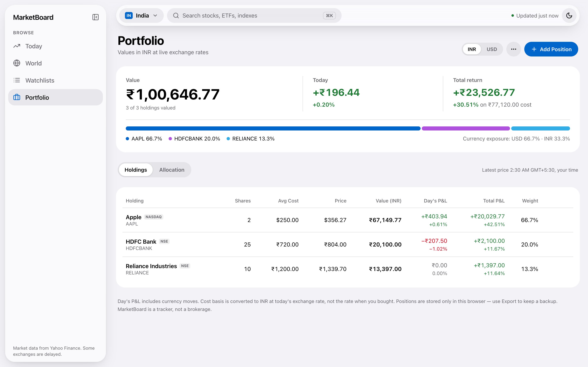
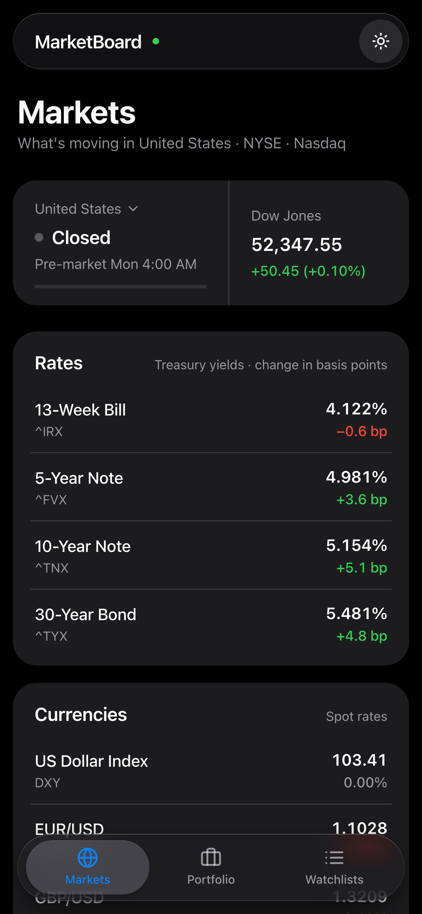

# MarketBoard

A markets dashboard, portfolio tracker and watchlist app with an Apple-style Liquid Glass interface, built with Next.js. Pick any of 16 markets worldwide and the whole app looks through it: that country's indexes, session, sectors, movers, currency and commodities, with your portfolio valued in its currency. Quotes, charts, index levels, rates, currencies, commodities, movers and ticker search come from Yahoo Finance through a small server route, so no API key is needed.

**Live:** [market-board-ecru.vercel.app](https://market-board-ecru.vercel.app)




## Features

Four destinations, **Today, World, Watchlists and Portfolio**, sit in a full-height glass sidebar on desktop (hide it to an icon rail with **⌃⌘S**) and in a floating glass tab bar on phones. The toolbar on every page carries the **market you're looking through**, **search** and the feed status. Every symbol anywhere opens its own page.

### The market lens
- **Pick a market once.** The button at the left of the toolbar lists all 16 markets with their local time and live session. Your choice drives Today, the Portfolio's currency and the symbol pages' breadcrumbs, is remembered, and stays in sync across tabs.
- **Local conventions.** Prices use each currency's own digit grouping (India in lakhs: ₹3,66,244.91), large rupee amounts read in crore (₹400.5 cr, ₹12.41 lakh cr), and times carry the zone a desk would use (IST, EDT, AEDT).

### Today
One question per section, in the order a desk asks them:
1. **How is my market doing?** One header card: open, pre-market, lunch, after hours, closed or holiday, with a countdown, a trading-hours bar and the as-of time; the main index large with its intraday line against a dashed previous close and the day's range; your other pinned indexes and the local volatility index (VIX, India VIX, ASX VIX); and **breadth**, how many of the market's largest listings are up and down.
   - **Pin up to three indexes** from **All indexes**, 46 in all (Dow, S&P 500 and Nasdaq; Nifty 50, Sensex and Nifty Bank; FTSE 100; Nikkei 225; …). Each market remembers its own.
   - **Holidays and early closes** are built in, and countdowns skip them ("Pre-market Tue 4:00 AM" before Martin Luther King Jr. Day).
2. **What's moving?** Sectors ranked best to worst beside movers (Gainers, Losers, Most active) with company names and value traded.
   - **Sectors** come from official indexes or funds in 8 markets (SPDRs, Nifty sectoral, S&P/ASX 200, TOPIX-17, CSI, Hang Seng, B3, iShares TSX) and are cap-weighted from the largest listings in the other 8.
   - **Movers** come from Yahoo's screeners in the US; elsewhere the app ranks each market's 28–40 largest listings, and most active means value traded, since share counts aren't comparable across prices.
3. **How is my list doing?** A strip of your watchlist with intraday sparklines.
4. **What's the context?** One card with tabs: Rates (US Treasury yields in basis points), Currencies (quoted the way local desks write them: USD/INR, EUR/USD, GBP/EUR, AUD/USD), Commodities and Crypto. Commodities and crypto are **priced in the local currency** with the dollar price underneath, and the day's change includes the currency's own move (gold +0.03% in dollars shows +0.24% in rupees when the rupee falls 0.21%).

<details>
<summary><strong>What each market shows</strong></summary>

| Market | Currency | Volatility | Sectors | Movers |
| --- | --- | --- | --- | --- |
| United States | USD | VIX | Select Sector SPDRs (11) | Yahoo screeners; breadth from 50 large caps |
| Canada | CAD | — | iShares TSX sector ETFs (8) | 34 large caps |
| Brazil | BRL | — | B3 sector indexes (7) | 28 large caps |
| United Kingdom | GBP | — | Computed | 35 large caps |
| Germany | EUR | — | Computed | 35 large caps |
| France | EUR | — | Computed | 34 large caps |
| Switzerland | CHF | — | Computed | 31 large caps |
| Saudi Arabia | SAR | — | Computed | 31 large caps |
| South Africa | ZAR | — | Computed | 35 large caps |
| India | INR | India VIX | Nifty sectoral indexes (12) | 40 large caps |
| China | CNY | — | CSI sector indexes (10) | 34 large caps |
| Hong Kong | HKD | — | Hang Seng sub-indexes (4) | 36 large caps |
| Japan | JPY | — | TOPIX-17 sector ETFs (17) | 40 large caps |
| South Korea | KRW | — | Computed | 37 large caps |
| Singapore | SGD | — | Computed | 29 large caps |
| Australia | AUD | ASX VIX | S&P/ASX 200 sectors (11) | 39 large caps |

Each market also has six commodities picked for its economy (soybeans, coffee and sugar for Brazil; platinum and palladium for South Africa; lumber for Canada; Dutch TTF gas for Europe) and its main currency pairs.

</details>

### World
All 16 markets in one table, grouped by region: session and next open, local time, main index, last, change and the last session's shape. Tiles above it answer the quick questions: how many are open, which opens next, how many were up and down, and the biggest move. Choosing a market makes it your lens and opens Today.

| World | Search |
| --- | --- |
|  |  |

### Search
**⌘K** (or the search field) from any page finds stocks, ETFs and indexes on every exchange Yahoo covers, with exchange, country and live price. **Enter** opens the symbol page; **⌘Enter** or **+** adds it to your watchlist without leaving. Recent searches show when the field is empty.

### Watchlists
- **Your lists live here:** each with its count and today's up/down, plus **New list**, rename and delete.
- **The list:** company names first, then ticker and exchange badge, an intraday sparkline, price in the stock's own currency and the day's change. Sort by your order, % change or name; filter; add any ticker; remove with × or Delete, with **Undo**.
- **Detail:** the selected stock's chart and stats beside the list, with **Open page**.



### Portfolio
- **Valued in your market's currency** (INR when India is your lens), with a USD switch. Holdings in other currencies convert at live exchange rates; today's change includes currency moves; prices in pence or other minor units are handled.
- **Three numbers on top:** value, today and total return on cost, with an allocation bar and currency exposure. **Holdings** and **Allocation** (by holding, sector and currency) are tabs.
- **Positions:** add with shares and average cost; buying more of something you hold merges at the weighted average. Edit or remove with **Undo**. A holding with no quote or rate is flagged and left out of the totals, never estimated.
- **Backup:** export your watchlists and portfolio as JSON, or import one, from the **⋯** menu.



<sub>The portfolio above is an example; prices and exchange rates are live.</sub>

### Symbol pages
- **Where it sits:** a breadcrumb to its market and sector, and **More in that sector** from the same market's largest listings.
- **Chart:** a 1D / 1W / 1M / 3M / 1Y / ALL range control with volume bars; moving the pointer shows the price and time at that point, the way Apple's Stocks app does. 1D shows the latest session against a dotted previous close, in the exchange's time zone.
- **Freshness:** "As of 3:28 PM IST · Market closed", how far a lagging quote is behind, and pre-market or after-hours prices when Yahoo has them. A new 52-week high or low is flagged.
- **Fundamentals** from the live quote, and **Add to Watchlist** / **Add to Portfolio**. Each symbol has its own link, e.g. `/symbol/AAPL`.

### Throughout
- **Light and dark appearance**, following your system until you pick one.
- **Phones:** a compact glass top bar (market, search, appearance) and a floating tab bar; every page fits without sideways scrolling, and pinch-zoom works.
- **Storage:** watchlists, positions, your market and pinned indexes are saved in this browser and kept in sync across tabs.

<p align="center">
  
</p>

<sub>Screenshots taken from the running app with live Yahoo Finance data on Sunday, November 15, 2026: most markets show Friday's close, and Saudi Arabia, which trades on Sundays, is open.</sub>

## Design

The interface follows Apple's Liquid Glass approach: content sits on a plain background (black, or the grouped grey of iOS Settings in light mode) on solid cards, and glass is used only for the floating layer of controls.

- **Glass for controls only.** The sidebar, the toolbar, the phone top bar and tab bar, segmented controls, sheets and toasts are translucent with background blur, a thin highlight along the top edge and a soft shadow. Numbers always sit on solid cards so they stay crisp.
- **Edge refraction.** In Chromium browsers (Chrome, Edge, Brave, Arc) the toolbar and the phone tab bar also bend the content beneath them at their rims, using an SVG displacement map with `backdrop-filter`. Safari and Firefox get the frosted blur without the bending.
- **Desk-grade numbers.** Tabular figures, right-aligned and always signed (+/−), so colour is never the only signal; provenance (source, delay, as-of time) on every screen.
- **Calm by default.** No ticking seconds or pulsing; prices roll digit by digit only when they change, and selections slide on spring animations.
- **System palette.** Apple's system colours for labels, separators, fills, green, red and blue, with separate light and dark sets.
- **Accessibility.** Text and colour-coded values meet WCAG AA contrast (4.5:1) in both appearances. Everything works by keyboard: ⌘K search with arrow keys, arrow keys through chart ranges, Delete on a watchlist row, and open sheets keep focus inside until closed.

## Where the data comes from

All market data comes from Yahoo Finance through [`yahoo-finance2`](https://github.com/gadicc/node-yahoo-finance2), called from the server route in `app/api/stocks/route.ts`. Some values are derived rather than fetched, and this table says which:

| Data | Source |
| --- | --- |
| Price, change, open, high, low, previous close | Live Yahoo quote |
| Volume, average volume, market cap, 52-week range | Live Yahoo quote |
| P/E, EPS, dividend yield, exchange, currency | Live Yahoo quote |
| Index levels (`^DJI`, `^NSEI`, `^BSESN`, `^N225`, …) | Live Yahoo quote for the real index |
| Chart history for every range | Live Yahoo chart data, regular-session bars only |
| Pre-market and after-hours prices | Live Yahoo quote |
| Rates, currencies, commodities, crypto, volatility, sector indexes and ETFs | Live Yahoo quotes |
| Commodities and crypto in local currency | **Computed** from the live USD (or EUR) quote and the live exchange rate |
| US movers (gainers, losers, most active) | Live Yahoo predefined screeners |
| Movers and computed sectors for other markets | **Computed** from live quotes for each market's largest listings |
| Sector and country for portfolio allocation | Yahoo company profile, cached for a day |
| Exchange rates for portfolio valuation | Live Yahoo FX quotes (`INRUSD=X`, `GBPUSD=X`, …) |
| Intraday sparklines | Live Yahoo 1D chart, downsampled on the server for many symbols at once |
| Breadth (up/down counts) | **Computed** from live quotes for each market's largest listings |
| Ticker search | Live Yahoo search (stocks, ETFs and indexes) |
| Market open/closed status | **Computed** from each exchange's hours and holiday rules, then **checked live** against Yahoo's session state for the market's main index |

**The app never invents data.** If Yahoo can't be reached, the last real prices stay on screen unchanged and the toolbar says **Reconnecting** with the time of the last good update. If there is no data at all, prices show "—" and the toolbar says **Offline**. A chart with no data shows an empty state with a **Try Again** button.

**Refresh rates.** Each of these is one batched request:
- **Every 10 seconds:** watchlist, portfolio and symbol-page quotes, including the exchange rates the portfolio needs.
- **Every 15 seconds:** on Today, indexes, currencies, commodities, crypto, sectors and the large-cap quotes behind breadth and movers.
- **Every minute:** each market's main index on every page (for the market picker, World and live session status), US movers, the main index's intraday line and the open 1D chart.
- **Every two minutes:** intraday sparklines on Today, World and Watchlists.
- **Once a day:** company profiles (sector and country), cached on the server.

The server caches results briefly, so several open tabs don't multiply the load on Yahoo. Refreshing slows down while the feed is failing and pauses while the tab is hidden.

Yahoo Finance has no official public API, so `yahoo-finance2` depends on unofficial endpoints. Heavy use can be rate-limited for a while.

## Getting started

You need Node.js 20.9 or later.

```bash
git clone https://github.com/shreyescodes/market-board-stocks.git
cd market-board-stocks
npm install
npm run dev
```

Then open http://localhost:3000.

| Command | What it does |
| --- | --- |
| `npm run dev` | Start the development server |
| `npm run lint` | Lint with ESLint and Next's rules |
| `npm run typecheck` | Type-check with TypeScript |
| `npm run build` | Create a production build |
| `npm start` | Serve the production build |

## Continuous integration and deployment

**CI.** Every pull request and every push to `main` runs [`.github/workflows/ci.yml`](.github/workflows/ci.yml) on GitHub Actions. It does a clean install (`npm ci`), then lint, then type-check, then build, and fails on the first error. Type-checking is its own step because `next.config.mjs` sets `ignoreBuildErrors`, so a passing build alone doesn't prove the types are sound.

Lint uses Next's Core Web Vitals and TypeScript rules as they ship, including the React Compiler rules (`set-state-in-effect`, `refs`, `purity`), with no overrides or `eslint-disable` comments. Browser-only state (saved choices, media queries, the clock) is read through `useSyncExternalStore` in `hooks/use-browser.ts`, which is what keeps those rules satisfied.

**Deployment.** The app needs a server for `/api/stocks`, so it can't be hosted as static files. It deploys to [Vercel](https://vercel.com) through Vercel's GitHub app, with no workflow file or secrets in this repo:
1. In Vercel, choose **Add New → Project** and import this repository. Next.js is detected automatically, and no environment variables are needed.
2. Deploy. From then on, every push to `main` deploys to production, and every pull request gets its own preview URL, posted on the PR.

The production site is at [market-board-ecru.vercel.app](https://market-board-ecru.vercel.app).
3. Optional: in GitHub, under **Settings → Branches**, protect `main` and require the **Lint, type-check and build** check, so nothing merges with a red CI.

On serverless hosts, each function instance keeps its own short-lived quote cache. Yahoo may also rate-limit cloud IP addresses sooner than a home connection. When that happens, the app shows **Reconnecting** with the last good prices rather than failing.

## API route

The front end talks only to `GET /api/stocks`:

| Query | Returns |
| --- | --- |
| `?action=quotes&symbols=AAPL,^GSPC` | Quotes, fundamentals, session state and extended-hours prices, up to 50 symbols per request. `stale: true` means Yahoo is unreachable and these are the last good values. Yahoo answers some dollar pairs under a different alias (`JPY=X` for `USDJPY=X`); the route always returns them under the symbol you asked for |
| `?action=chart&symbol=AAPL&timeframe=1M` | Price and volume history for `1D`, `1W`, `1M`, `3M`, `1Y` or `ALL`, with the exchange's time zone |
| `?action=movers` | Top 10 US gainers, losers and most active. Cached for a minute |
| `?action=profiles&symbols=AAPL,SPY` | Sector, industry, country and instrument type. Cached for a day |
| `?action=sparks&symbols=AAPL,^NSEI` | The latest session's prices, downsampled for small charts, for up to 40 symbols in one call (from the 1D chart cache) |
| `?action=search&query=netflix` | Up to eight matching stocks, ETFs or indexes |

## Adding or changing a market

Everything Today shows for a market lives in its entry in `lib/market-profiles.ts`; the page itself has no per-country code.

1. **Exchange hours and status:** add the market to `MARKETS` in `lib/markets.ts` (and its holiday rules to `lib/holidays.ts` if they are predictable).
2. **Indexes:** add its indexes to `INDEX_CATALOG` in `lib/indices.ts`. The first three are the default pinned indexes in the header.
3. **Profile:** add an entry to `PROFILES` with:
   - `currency`: the ISO code everything is priced in
   - `fx`: counter currencies; pairs and their direction are built for you
   - `commodities`: six keys from `COMMODITIES`
   - `volatility` (optional): the local volatility index
   - `sectors` (optional): sector indexes or ETFs. Leave it out and sectors are computed from `largeCaps`, which then need a sector on each entry (use `tag()`)
   - `largeCaps`: the universe for breadth, movers and same-sector peers, as tickers plus the Yahoo suffix (`.NS`, `.L`, `.T`, …), tagged with sectors via `tag()`. Keep it to 50 or fewer
4. **Check every symbol** returns a live, current quote from `/api/stocks?action=quotes&symbols=…` before committing. Yahoo renames and drops tickers, and a missing one shows as "—" rather than an error.

## Project structure

```
app/
  layout.tsx              Root layout and link-preview metadata
  page.tsx                Today
  world/page.tsx          World
  watchlists/page.tsx     Watchlists
  portfolio/page.tsx      Portfolio
  symbol/[symbol]/page.tsx  A page per symbol
  api/stocks/route.ts     Yahoo Finance proxy: quotes, charts, sparks, movers, profiles, search
  globals.css             Design tokens and the glass material
components/
  app-shell.tsx           Glass sidebar, toolbar wiring (search, market picker, ⌘K) and phone tab bar
  header.tsx              Desktop toolbar and phone top bar: market lens, search, feed status
  market-context.tsx      The market lens and the shared feed of each market's main index
  market-picker.tsx       Choose a market: local time and live session for all 16
  search.tsx              ⌘K search: open a symbol or add it to a watchlist
  markets-view.tsx        Today: header, sectors, movers, watchlist strip, context tabs
  indexes-sheet.tsx       Every index for the market; pin up to three to the header
  world-view.tsx          World: all markets in one table
  watchlists-view.tsx     Watchlists: your lists, the list and the detail
  watchlist-table.tsx     The list: sort, filter, add, select, remove
  watchlists-sheet.tsx    Create, rename and delete watchlists
  portfolio-view.tsx      Portfolio in the lens currency
  position-sheet.tsx      Add / edit a position
  symbol-view.tsx         Symbol page: breadcrumb, details, same-sector peers
  stock-details.tsx       Price header, range control, chart, fundamentals
  segmented.tsx           Segmented control with a sliding glass thumb
  sparkline.tsx           Small session chart against the previous close
  liquid-glass.tsx        Glass surface, edge refraction, rolling numbers, change pill
  sheet.tsx               Glass sheet used for pickers and forms
hooks/
  use-poll.ts             Polling with back-off that pauses in hidden tabs
  use-quotes.ts           Batched live quotes for any set of symbols
  use-sparks.ts           Batched intraday sparklines
  use-browser.ts          Hydration-safe browser state: saved choices, media queries, the clock
lib/
  storage.ts              Browser storage, migration and backup files
  portfolio.ts            Portfolio valuation in any base currency, and allocation
  indices.ts              Indexes for each market, with their exchange
  market-profiles.ts      Per-market currency, FX pairs, commodities, sectors and large caps
  markets.ts              Exchange hours, open/closed status, zone names, symbol → market
  holidays.ts             Holiday and early-close calendars computed from exchange rules
  stock-data.ts           Client fetch helpers (quotes, charts, sparks, movers, profiles)
  format.ts               Prices, money and times per currency and local convention
  stock-types.ts
```

## Tech stack

- [Next.js 16](https://nextjs.org) with the App Router, React 19 and TypeScript
- [Tailwind CSS 4](https://tailwindcss.com)
- [Framer Motion](https://motion.dev) for animation
- [Recharts](https://recharts.org) for the chart
- [yahoo-finance2](https://github.com/gadicc/node-yahoo-finance2) for market data
- [Sonner](https://sonner.emilkowal.ski) for notifications and [Lucide](https://lucide.dev) for icons

## Privacy

- **No accounts.** Your watchlists and positions are stored only in your browser, never on a server.
- **What leaves the browser:** to fetch prices, the app sends ticker symbols (for example `AAPL`) to its own server route, which asks Yahoo Finance. Share counts, costs and portfolio values are never sent.
- **Analytics:** the layout includes [Vercel Web Analytics](https://vercel.com/docs/analytics), which collects anonymous page views only when the app is deployed on Vercel with Analytics turned on. It does nothing locally.

## Limitations

- **Two kinds of holiday coverage:**
  - **Rule-based calendars** cover 10 markets: the US, Canada, Brazil, the UK, Germany, France, Switzerland, South Africa, Australia and Japan.
  - **Live status only** for China, Hong Kong, India, South Korea, Singapore and Saudi Arabia. Their holidays come from lunar or religious calendars announced each year, so on the day these markets show **Closed Today** once Yahoo confirms there has been no trading, but countdowns before the holiday don't account for it.
- **Unpredictable closures:** rules can't foresee one-off closures such as state funerals or emergencies. The live check catches those on the day.
- **Clock changes:** countdowns that span a daylight-saving change can be off by an hour.
- Edge refraction works only in Chromium browsers.
- **Browser-only storage.** Watchlists and positions live in this browser. They don't sync to other devices, and clearing site data erases them, so use **Export** to keep a backup.
- **Portfolio cost basis** is converted to USD at today's exchange rate, not the rate on the day you bought. Positions are a single average cost per symbol, not individual lots, and there are no realized gains, dividends or taxes. It is a tracker, not a brokerage record.
- **Movers outside the US come from a fixed list of large caps,** because Yahoo's screeners only cover US listings. A small-cap surge in those markets won't appear.
- **Government bond yields are US-only,** because Yahoo carries no other sovereign yields.

## License

[MIT](LICENSE). Market data comes from Yahoo Finance and is subject to its terms; this project is not affiliated with Yahoo.
